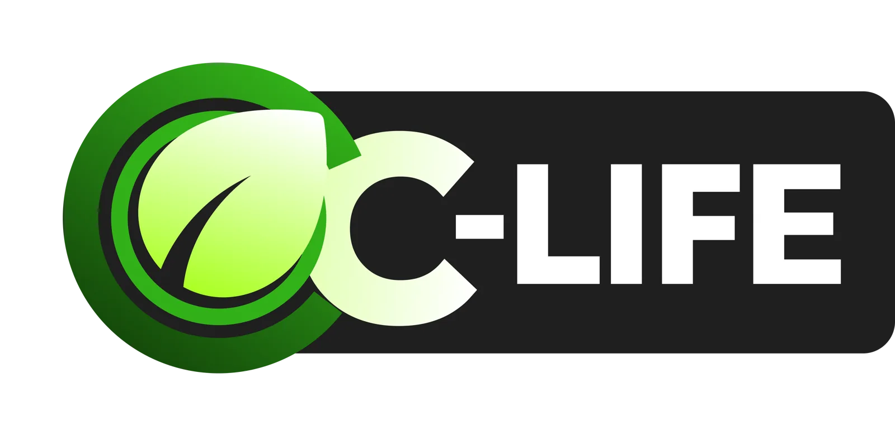

<p align="center">
  
</p>

<h3 align="center">Sisa Terukur, Nilai Berputar.</h3>

<p align="center">
  Website company profile <b>OC-Life</b>, platform SaaS pelacakan dan koordinasi limbah organik kawasan pangan.<br>
  BPC IDEANATION 2026 · SB-IPB
</p>

<p align="center">
  
  
  
  
</p>

---

## Tentang OC-Life

Sisa makanan dari kantin, Sentra Wisata Kuliner (SWK), dan food court dicatat per wadah, dicek mutunya, lalu disalurkan sebagai bahan baku biogas. Hasil penjualan bioslurry ke KUD/Gapoktan membiayai e-voucher LPG 3 kg untuk tenant yang memilah. Skema ini disebut **subsidi silang sirkular**.

| Pihak | Manfaat |
| --- | --- |
| **Pengelola kawasan** | Biaya angkut turun hingga 50%, plus data pemilahan untuk UI GreenMetric/ESG |
| **Tenant** | E-voucher LPG 3 kg gratis dari poin sirkular |
| **Operator biodigester** | Pasokan bahan baku yang terukur, bersih, dan tertelusur |
| **Petani** | Bioslurry (pupuk organik cair) dengan harga grosir |

## Isi halaman

| Section | Isi |
| --- | --- |
| Hero | Slideshow key visual (penjemputan → hub → biodigester → koperasi → ladang) + mockup dashboard |
| Dari kios ke ladang | Lima perhentian satu kilogram sisa makanan |
| Masalah | Data timbulan sampah dan *pain point* tiap pihak |
| Cara kerja | Alur *chain of custody* dari kios hingga energi |
| Fitur | Demo interaktif lima modul (tenant, petugas, operator, koperasi, pengelola) |
| Subsidi silang | Simulator: geser parameter, lihat perputaran nilai per lokasi |
| Dampak & model bisnis | Proyeksi 3 tahun dan pembagian manfaat |
| Mitra | Grid logo mitra ekosistem + marquee peran |
| Peta jalan, referensi, kontak | Tahapan pengembangan, sumber data, formulir audit 14 hari |

## Menjalankan

```bash
npm install
npm run dev       # http://localhost:5173
npm run build     # hasil di dist/
npm run preview   # pratinjau hasil build
```

## Struktur

```
public/
  kv/        logo OC-Life + key visual (webp)
  mitra/     logo mitra ekosistem
  img/       mockup & ikon 3D
src/
  App.tsx    seluruh section halaman
  demo.tsx   demo interaktif per modul
  ui.tsx     komponen bersama (Reveal, SectionHead, Counter)
  index.css  token warna & animasi (forest · leaf · mint · sun · cream)
```

## Deploy

Ini SPA statis, jadi bisa di-import langsung di [Vercel](https://vercel.com/new). Framework Vite terdeteksi otomatis, build command `npm run build`, output `dist`.

## Proyek terkait

- **Demo simulasi untuk juri:** [OC-Life-Demo-Website](https://github.com/Naufal-Ghani22/OC-Life-Demo-Website)

---

<p align="center"><sub>Seluruh pihak pada section Mitra berstatus calon mitra hingga tercapai kesepakatan tingkat layanan (SLA) tertulis.</sub></p>
